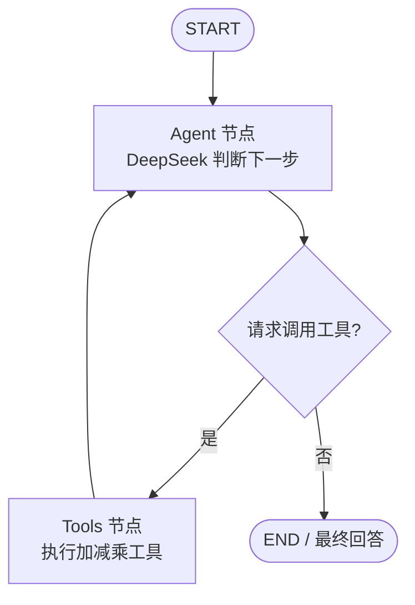

# Lesson 03 — 用 LangGraph 实现具有状态管理的多工具 Agent

本课程属于 `agent-from-scratch` 系列，承接第二课 `02_multi_tool_agent`。

## 本课目标

第二课我们用 `for` 循环手动管理 DeepSeek 的工具调用。本课使用 LangGraph 的 `StateGraph`，把执行步骤改造成有状态、可根据条件自动流转的工作流。

学完应理解：

1. **State（状态）**：保存对话消息和模型调用次数。
2. **Node（节点）**：负责执行某项具体工作。
3. **Edge（边）**：让节点之间按顺序执行。
4. **Conditional Edge（条件边）**：根据模型是否请求工具决定下一节点。
5. **ToolNode**：执行工具并生成对应的工具回复。

## 执行流程



## 项目结构

```text
tutorials/
├── 01_tool_calling/
├── 02_multi_tool_agent/
└── 03_langgraph_agent/
    ├── main.py           # LangGraph Agent 示例
    ├── requirements.txt  # 安装依赖
    ├── .env.example      # API 密钥配置示例（可公开）
    ├── .gitignore        # 防止泄漏本地密钥与环境
    └── README.md         # 当前教程
```

## 快速开始（Windows PowerShell）

### 1. 在第三课目录打开终端

```powershell
cd tutorials/03_langgraph_agent
```

### 2. 创建虚拟环境，安装依赖

```powershell
py -m venv .venv
.\.venv\Scripts\python.exe -m pip install -r requirements.txt
```

### 3. 配置 DeepSeek API Key

```powershell
Copy-Item .env.example .env
notepad .env
```

在打开的 `.env` 文件中，将 `your_deepseek_api_key_here` 替换为自己的 API Key。

**绝对不要将 `.env` 提交到 GitHub**。`.env.example` 只包含占位符，可以公开。

### 4. 启动程序

```powershell
.\.venv\Scripts\python.exe main.py
```

输入：

```text
先计算 12 + 8，再把结果乘以 3。
```

预期数值答案为 `60`。模型可能通过一次或多次工具调用完成，调用顺序以实际输出为准。

输入 `q` 退出。

## 关键代码解读

### 定义状态

```python
class AgentState(TypedDict):
    messages: Annotated[list[BaseMessage], add_messages]
    llm_calls: int
```

- `messages` 是消息历史；`add_messages` 把新消息合并进已有历史，避免节点输出直接覆盖对话。
- `llm_calls` 记录当前提问调用大模型的次数。

### 定义节点

```python
builder.add_node("agent", call_model)
builder.add_node("tools", ToolNode(TOOLS))
```

- `agent`：调用 DeepSeek，决定回复用户还是调用工具。
- `tools`：运行 `add`、`subtract`、`multiply` 中指定的工具。

### 定义路由和循环

```python
builder.add_edge(START, "agent")
builder.add_conditional_edges(
    "agent",
    route_after_model,
    {"tools": "tools", "end": END},
)
builder.add_edge("tools", "agent")
```

这里相当于把第二课手工编写的循环改造成清晰的状态图。模型不再需要工具时，就会走到 `END`。

### 编译并执行

```python
agent = builder.compile()
```

主程序通过 `.stream(..., stream_mode="updates")` 输出各节点执行过程，方便调试。

## 练习题

1. 让 Agent 计算 `(25 - 7) * 4`，验证结果是否为 `72`。
2. 自己新增一个 `divide(a, b)` 除法工具，并处理除数为 0 的情况。
3. 在执行日志中区分 `agent` 节点与 `tools` 节点。
4. 思考：如果要加入“人工审批”节点，应该放在条件判断的哪个分支？

## 与第二课的对比

| 第二课 | 第三课 |
| --- | --- |
| 手写循环控制工具调用 | LangGraph 的条件边控制执行路径 |
| `messages` 列表手动维护 | `AgentState` 统一维护状态 |
| 根据 tool_calls 手动执行工具 | `ToolNode` 管理工具执行 |
| 手写退出条件 | `END` 表示工作流结束 |
| 执行步骤混在一个函数里 | 节点功能清晰、容易扩展 |

## 常见问题

**Q: `ModuleNotFoundError: No module named 'langgraph'`**

A: 确认已执行依赖安装命令，并使用 `.venv` 中的 Python 运行程序。

**Q: `未设置 DEEPSEEK_API_KEY`**

A: 检查是否复制了 `.env.example` 到 `.env`，并填写真实 API Key。

**Q: 401 鉴权错误？**

A: 检查 API Key 是否正确，以及 API 账户是否可调用目标模型。

**Q: 为什么要写 `add_messages`？**

A: 节点只返回本次新增的消息，LangGraph 将其与已有消息合并。否则可能丢失上一轮工具调用与结果。

**Q: 模型为什么没有调用工具？**

A: 工具调用由模型决定，提示词只是引导；可以检查工具说明，或换一个明确的计算问题。

> 本课是教学示例，不含持久化记忆、权限系统、人工审批或生产环境错误治理。图执行使用 `recursion_limit` 防止意外无限循环。

## 参考资料

- [LangGraph 官方 Quickstart](https://docs.langchain.com/oss/python/langgraph/quickstart)
- [LangGraph Graph API](https://docs.langchain.com/oss/python/langgraph/graph-api)
- [DeepSeek API 接入](https://api-docs.deepseek.com/zh-cn/)

## 下一课预告

Lesson 04：LangGraph + 多轮记忆（Checkpointer），让 Agent 在多次提问之间保留对话上下文。
